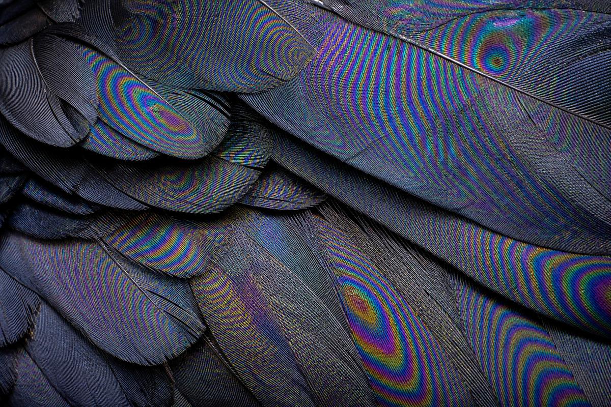
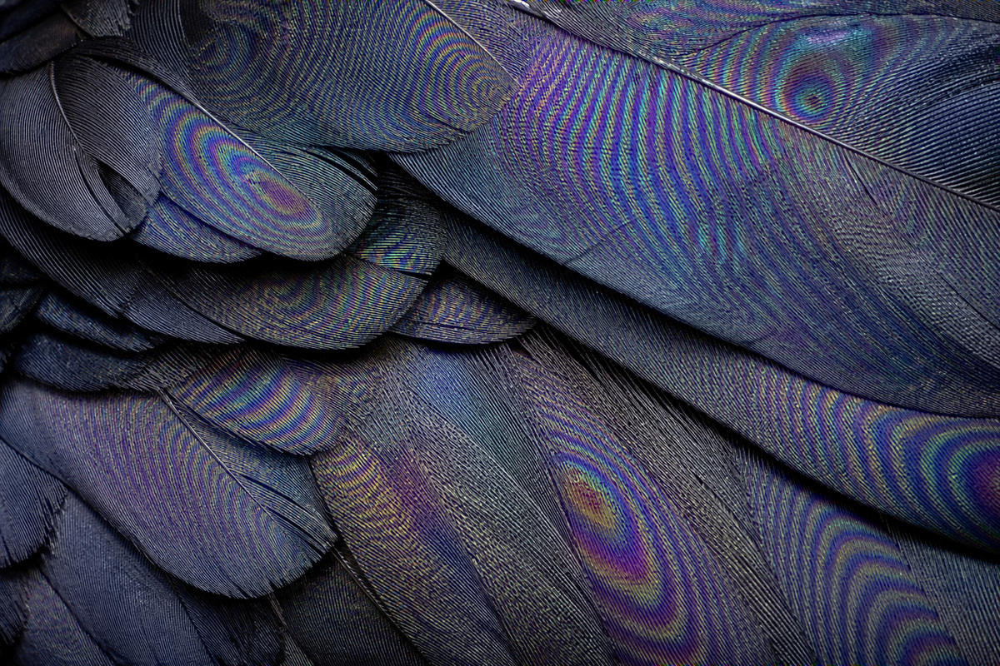
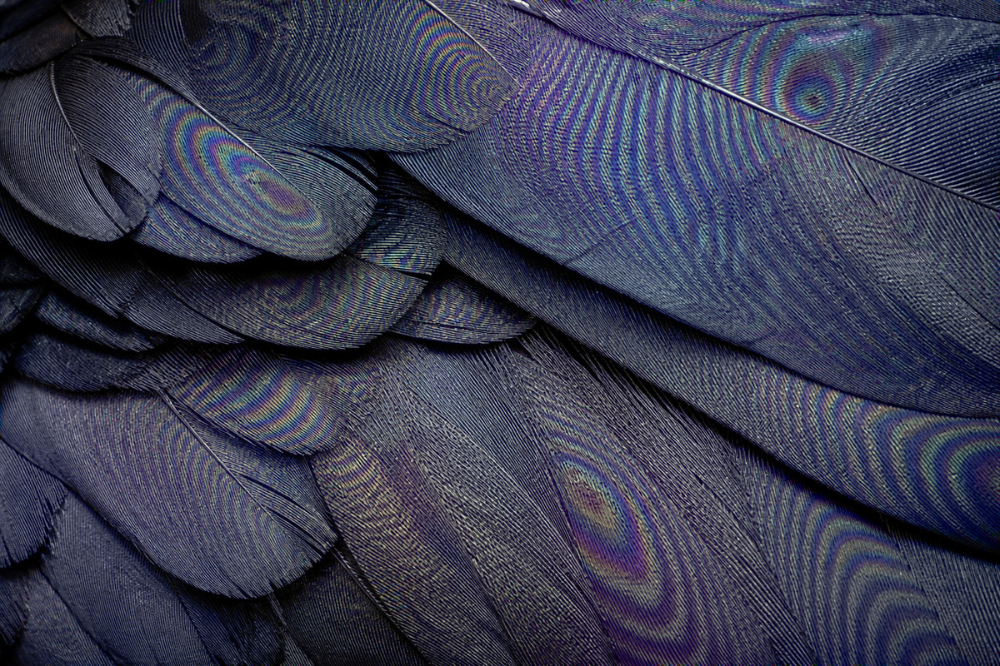
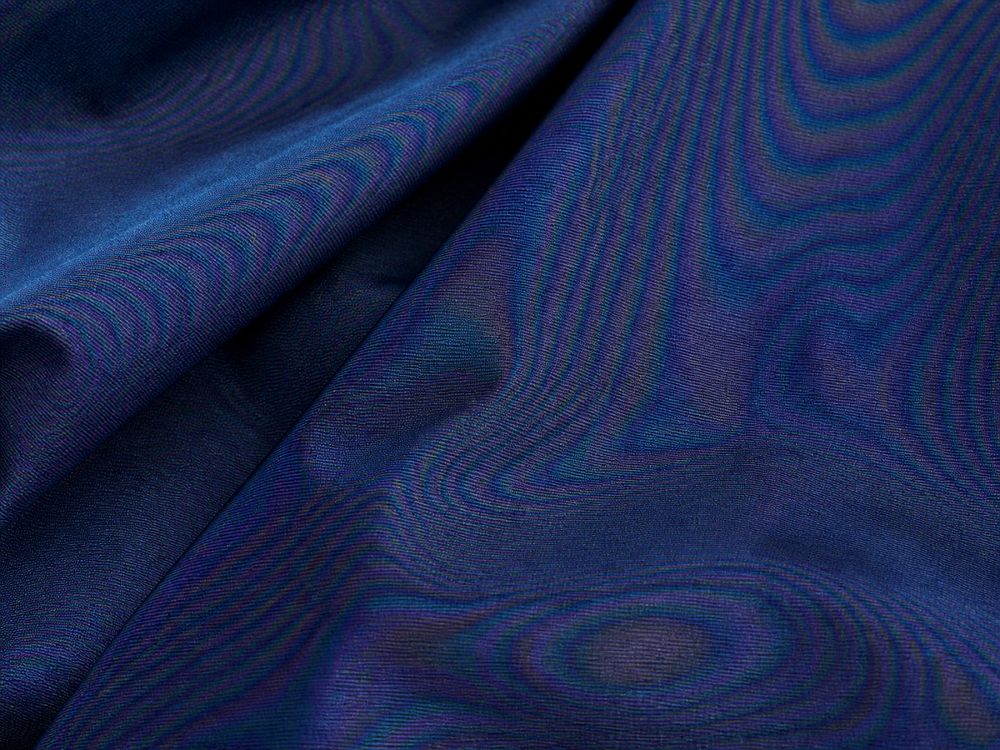
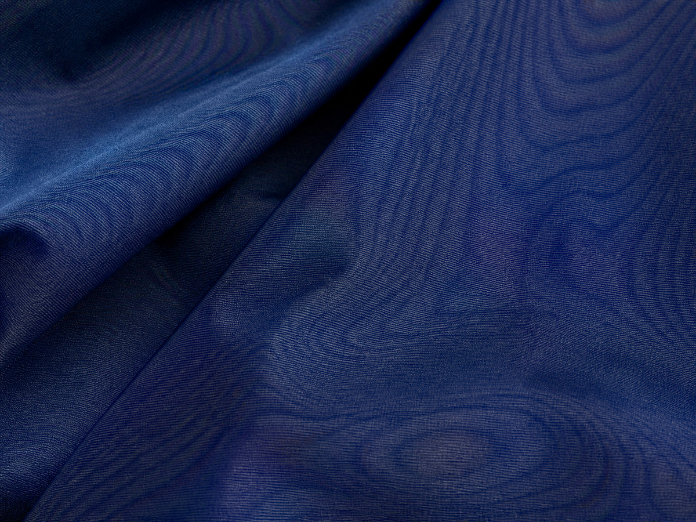

# Nevermoire

**Local, classical moire detection and suppression for photographs.**

[](LICENSE)
[](https://nodejs.org/)

Nevermoire is a small, deterministic command-line tool for reducing chromatic
and moderate luminance moire. It runs entirely on the local CPU and uses tiled
frequency analysis, adaptive Gaussian notch filters, confidence-weighted
reconstruction, and optional luminance-guided chroma smoothing.

It contains **no neural networks, model weights, telemetry, cloud APIs, or
network calls during image processing**.

> [!IMPORTANT]
> Nevermoire is experimental software. It can suppress false periodic signals,
> but it cannot recover detail physically destroyed by aliasing. Review important
> results at 100% zoom and keep the original photograph.

## Results

### Black feathers: dense rainbow moire

Fine, highly periodic feather barbs create an intentionally difficult test for
any classical filter. The balanced profile reduces the false colour while
retaining most local colour variation. The strong profile uses a wider guided
chroma radius to suppress the large rainbow rings. Neither profile changes the
luminance channel, so the fine feather structure remains sharp.

| Original | Balanced | Strong |
| :---: | :---: | :---: |
|  |  |  |

<details>
<summary>Reproduce this comparison</summary>

Balanced:

```sh
nevermoire docs/assets/raven-moire-original.jpg \
  -o docs/assets/raven-moire-balanced.jpg \
  --mode auto \
  --strength 0.82 --threshold 4 --notch-width 1.9 \
  --max-peaks 5 --chroma-smooth 18 --smooth-strength 1 \
  --quality 94
```

Strong:

```sh
nevermoire docs/assets/raven-moire-original.jpg \
  -o docs/assets/raven-moire-strong.jpg \
  --mode auto \
  --strength 1 --threshold 3.2 --notch-width 3.5 \
  --max-peaks 10 --chroma-smooth 80 --smooth-strength 1 \
  --quality 94
```

</details>

### Dark fabric: broad chromatic moire

This example contains slower colour waves laid over visible woven texture. The
balanced profile removes most of the coloured interference while preserving the
cloth's tonal folds. Strong increases both spectral attenuation and the chroma
smoothing radius for a cleaner, more neutral result.

| Original | Balanced | Strong |
| :---: | :---: | :---: |
|  |  |  |

<details>
<summary>Reproduce this comparison</summary>

Balanced:

```sh
nevermoire docs/assets/fabric-moire-original.jpg \
  -o docs/assets/fabric-moire-balanced.jpg \
  --mode auto \
  --strength 0.82 --threshold 4 --notch-width 1.9 \
  --max-peaks 5 --chroma-smooth 18 --smooth-strength 1 \
  --quality 94
```

Strong:

```sh
nevermoire docs/assets/fabric-moire-original.jpg \
  -o docs/assets/fabric-moire-strong.jpg \
  --mode auto \
  --strength 1 --threshold 3.2 --notch-width 3.5 \
  --max-peaks 10 --chroma-smooth 40 --smooth-strength 1 \
  --quality 94
```

</details>

The public JPEGs are metadata-free. Dimensions and checksums are recorded in
[`docs/assets/README.md`](docs/assets/README.md).

## Features

- Fully local, deterministic CPU processing.
- No neural models or runtime downloads.
- Single-frame JPEG, PNG, WebP, and TIFF input/output through `sharp`/libvips.
- Linear-light luminance and opponent-chroma processing.
- Overlapping local FFT analysis instead of one global spectrum.
- Robust radial spectral whitening and narrow peak detection.
- Gaussian notch filters with confidence-dependent blending.
- Optional conservative luminance correction.
- Luminance-guided chroma smoothing for broad colour waves.
- Texture protection for patterns present in both chroma and luminance.
- Confidence-mask and portable JSON diagnostics.
- Output metadata removal by default.
- An 8-megapixel decoded-input limit by default and bounded resource parameters.

## Requirements

- Node.js 20, 22, or 24
- npm

`sharp` is the only runtime dependency. Nevermoire itself does not use OpenCV,
Python, a GPU runtime, or an AI framework.

## Installation

Clone the repository and install the locked dependencies:

Clone the repository using the URL shown by GitHub, then run:

```sh
cd nevermoire
npm ci
```

Run it directly:

```sh
node src/cli.mjs input.jpg -o output.jpg
```

Or create a local command linked to this checkout:

```sh
npm link
nevermoire input.jpg -o output.jpg
```

## Quick start

Default conservative chroma correction:

```sh
nevermoire photo.jpg -o cleaned.jpg
```

Screen photograph with cautious luminance correction:

```sh
nevermoire screen.jpg -o cleaned.png --mode screen
```

Periodic fabric with luminance/chroma texture protection:

```sh
nevermoire fabric.jpg -o cleaned.png --mode fabric
```

Broad colour waves with guided chroma smoothing:

```sh
nevermoire fabric.jpg -o cleaned.png \
  --mode chroma-only --chroma-smooth 18 --smooth-strength 1
```

Detection and diagnostics without writing a corrected image:

```sh
nevermoire photo.jpg --dry-run \
  --mask diagnostics/mask.png \
  --report diagnostics/report.json
```

## Processing pipeline

```text
decode and apply orientation
        │
        ▼
linear sRGB → luminance Y + chroma Cb/Cr
        │
        ▼
overlapping sine-windowed tiles
        │
        ├── packed chroma FFT (Cb = real, Cr = imaginary)
        └── optional luminance FFT
        │
        ▼
radial spectral whitening → local peak pairs
        │
        ▼
neighbour coherence + texture protection
        │
        ▼
soft Gaussian notch filters
        │
        ▼
inverse FFT + weighted overlap-add
        │
        ▼
edge/activity/confidence blending
        │
        ▼
optional luminance-guided chroma filter
        │
        ▼
linear RGB → sRGB → metadata-free output
```

### 1. Colour representation

Nevermoire converts byte-encoded sRGB to linear RGB, then separates luminance
from two opponent chroma planes. Colour moire is frequently much stronger in
chroma than in luminance, so the default mode can correct colour while leaving
fine luminance detail untouched.

### 2. Tiled frequency analysis

A single FFT cannot represent a frequency that changes across the frame because
of perspective or surface curvature. Nevermoire instead analyses overlapping
power-of-two tiles. A sine window reduces boundary leakage. Cb and Cr are packed
into the real and imaginary components of one complex transform, so both colour
planes share one FFT.

For each radius in the local spectrum, Nevermoire estimates a robust background
from the lower 85% of log-power values. Narrow local maxima are scored using
their deviation from that background, energy ratio, symmetric counterpart, and
support from neighbouring tiles.

### 3. Texture protection

Real fabric, feathers, hair, fences, and printed lines are also periodic. In
`fabric` mode Nevermoire analyses luminance even when it does not modify it. A
chroma peak that closely matches a luminance peak is treated as likely genuine
coloured texture and its correction confidence is strongly reduced.

This is deliberately conservative: leaving some moire is preferable to
destroying real structure.

### 4. Classical restoration

Each accepted frequency pair receives a soft Gaussian notch:

```text
H(u,v) = 1 - a · exp(-d(u,v)² / (2σ²))
```

`a` is derived from mode, strength, and confidence; `σ` is controlled by
`--notch-width`. Frequencies are attenuated rather than zeroed to reduce ringing.
Inverse-transformed tiles are reconstructed with weighted overlap-add.

The filtered result is blended with the original using the detection confidence,
local chroma activity, and an edge-protection term. Luminance attenuation is
lower than chroma attenuation and disabled by default.

### 5. Guided chroma smoothing

Some moire forms broad colour bands instead of isolated narrow FFT peaks.
`--chroma-smooth` applies a classical guided filter to the chroma planes, using
the restored luminance as the guide. Colour can therefore be smoothed across
fine false variation while boundaries represented in luminance remain visible.

The guided stage is opt-in because large radii can remove legitimate colour
variation.

## Modes

| Mode | Luminance correction | Texture protection | Intended use |
| --- | :---: | :---: | --- |
| `auto` | No | No | General conservative chroma correction |
| `screen` | Yes, weak | No | Photographed displays and mixed luma/chroma interference |
| `fabric` | No by default | Yes | Fabrics, feathers, hair, grids, and genuine periodic detail |
| `chroma-only` | Never | No | Safest option when the luminance plane must remain algorithmically unfiltered |

`--luma` enables cautious luminance correction except in `chroma-only` mode.
`--chroma-only` explicitly disables it regardless of another selected mode.

## CLI reference

```text
nevermoire <input> [options]

-o, --output <file>       Output image (default: <input>.nevermoire.<ext>)
--mode <name>             auto, screen, fabric, or chroma-only
--strength <0..1>         Overall notch-filter strength (default: 0.75)
--tile <pixels>           FFT tile size: power of two, 32..1024 (default: 128)
--step <pixels>           Tile step: 1..tile size (default: 96)
--threshold <number>      Spectral z-score threshold (default: 4.6)
--min-frequency <0..0.5> Lowest analysed cycles/pixel (default: 0.035)
--max-frequency <0..0.5> Highest analysed cycles/pixel (default: 0.46)
--max-peaks <number>      Frequency pairs per tile: 1..16 (default: 3)
--notch-width <number>    Gaussian width in FFT bins: >0..32 (default: 1.35)
--chroma-smooth <pixels>  Guided chroma radius: 0..256 (default: 0/off)
--smooth-strength <0..1>  Guided-filter blend (default: 0.85)
--luma                    Enable conservative luminance correction
--luma-strength <0..1>    Luminance-notch attenuation (default: 0.38)
--chroma-only             Never modify luminance
--mask <file>             Write the confidence mask as PNG
--report <file>           Write a portable JSON detection report
--diagnostics <dir>       Write mask.png and report.json to a directory
--quality <1..100>        JPEG/WebP output quality (default: 95)
--max-input-pixels <n>    Decoded pixel limit (default: 8000000, max: 30000000)
--dry-run                 Detect without writing a corrected image
-h, --help                Show help
-v, --version             Show version
```

Nevermoire refuses to use the same file for the input and any output, mask, or
report. Supported output extensions are `.jpg`, `.jpeg`, `.png`, `.webp`, `.tif`,
and `.tiff`. Input content is restricted to single-frame JPEG, PNG, WebP, or
TIFF even if a different format is renamed to use one of those extensions.

## Diagnostics

The grayscale mask encodes the final spatial correction confidence after edge
and activity protection. White means a stronger permitted change; black means
the original is retained.

The JSON report includes:

- image dimensions and tile grid;
- total and active tile counts;
- detected normalized frequencies and FFT-bin coordinates;
- robust spectral scores and energy ratios;
- neighbour support;
- luminance/chroma distance and texture-protection decisions.

Input/output names and filesystem paths are intentionally excluded.

## Privacy and security

- Image processing performs no network requests.
- Outputs omit EXIF, XMP, IPTC, GPS, comments, orientation, and device metadata.
- Decoded images are limited to 8 million pixels by default to reduce
  memory-exhaustion risk. Users with sufficient RAM can explicitly raise the
  limit with `--max-input-pixels`, up to a hard ceiling of 30 million.
- User-controlled tile, peak, notch, and smoothing values are bounded.
- The CLI refuses input/output aliasing and accidental input overwrites.
- No credentials, environment variables, user names, absolute developer paths,
  or private keys are required by the application.

Nevermoire depends on `sharp` and libvips to parse untrusted images. Keep the
lockfile and dependency up to date, review Dependabot alerts, and see
[SECURITY.md](SECURITY.md) for vulnerability reporting.

## Performance

The current implementation prioritises clarity and portability. FFT work is
written in JavaScript and executed on the CPU; image decoding/encoding uses
native libvips through `sharp`. Runtime grows with image area, tile overlap, and
enabled luminance analysis. `screen` and `fabric` are slower than the default
because they compute an additional luminance spectrum.

For large photographs, start with the default `128`-pixel tile and `96`-pixel
step. Smaller steps improve spatial continuity but increase work. Larger tiles
improve frequency resolution but consume more memory and can model perspective
changes less locally.

## Limitations

- Destroyed source detail cannot be reconstructed classically.
- Broadband or rapidly varying moire may not form isolated spectral peaks.
- Strong monochrome moire can be indistinguishable from genuine texture.
- JPEG artefacts can produce false peaks.
- Guided chroma smoothing may remove real local colour variation.
- Automatic confidence is an engineering heuristic, not a calibrated
  probability.
- Version 0.1 has been tested on synthetic fixtures and a small number of real
  examples; it is not yet a benchmarked production-grade demoiring system.

## Development

```sh
npm ci
npm run check
npm audit --omit=dev
```

Generate and process the synthetic demonstration:

```sh
npm run demo:generate
node src/cli.mjs demo-output/synthetic-moire.png \
  -o demo-output/cleaned.png \
  --diagnostics demo-output/diagnostics
npm run demo:measure -- demo-output/cleaned.png
```

The numerical core is in [`src/core.mjs`](src/core.mjs), the standalone FFT is
in [`src/fft.mjs`](src/fft.mjs), and image I/O plus CLI handling live in
[`src/cli.mjs`](src/cli.mjs). The separation is intentional so the numerical
core can later be ported to Rust without redesigning the algorithm.

See [CONTRIBUTING.md](CONTRIBUTING.md) before submitting a change.
Release history is recorded in [CHANGELOG.md](CHANGELOG.md).

## Project status

Nevermoire is an **experimental 0.1 release**. The current priority is building
a redistributable real-world benchmark containing both true moire and difficult
negative examples, then improving calibration without adding neural models.

## Licence

Code is available under the [MIT License](LICENSE).
